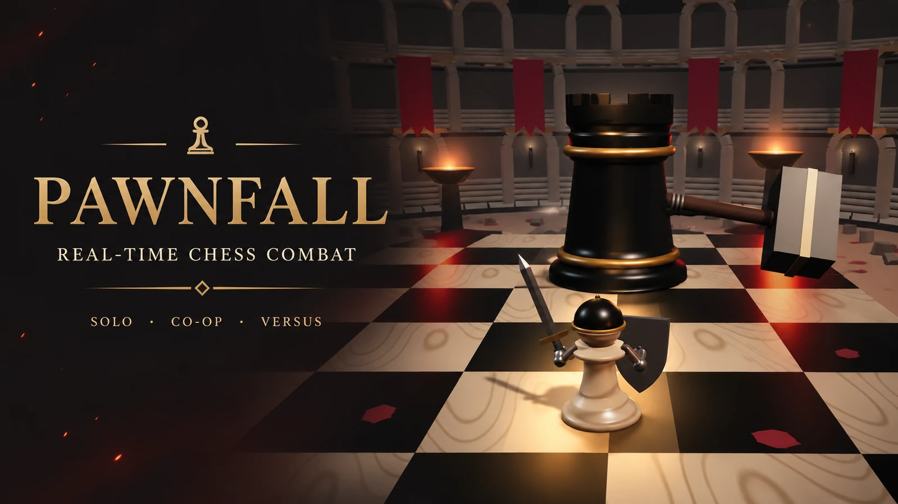
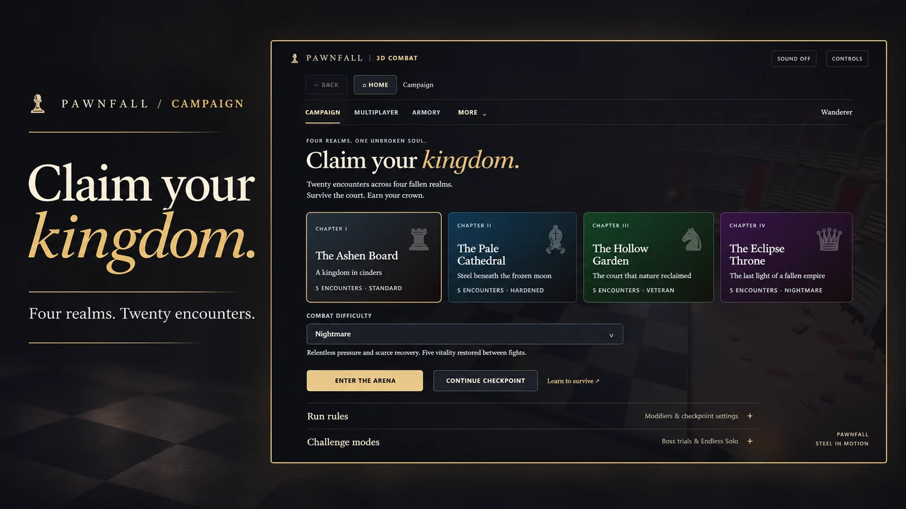
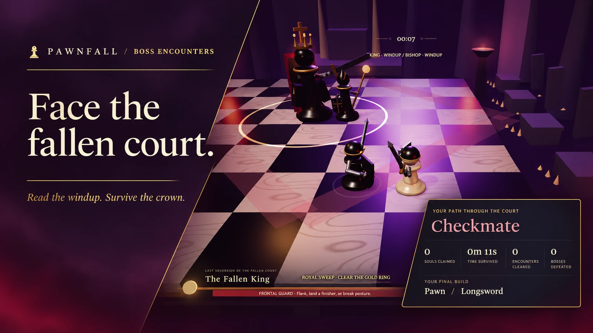
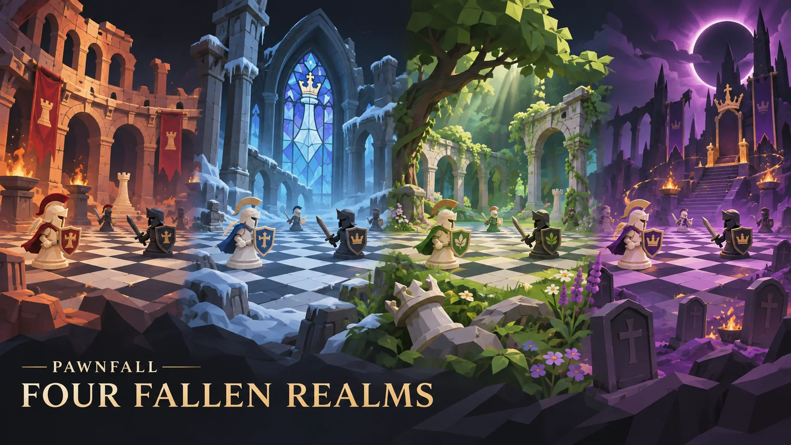

# Pawnfall



A real-time 3D chess combat game for the browser. Fight through fallen courts with a sword, shield, and the movement-inspired ability of your chosen chess piece. Manage stamina, read enemy windups, parry at the moment of impact, and punish an exposed boss.

Play a solo campaign, survive an endless run, clear a co-op expedition, or face another player in a versus duel. The arena combines an ivory-and-obsidian board with ruined coliseums, frozen cathedral arches, overgrown gardens, and an eclipsed throne.

## Features

- **Real-time combat:** six weapons, light and heavy attacks, combos, directional guarding, timed parries, rolls, posture breaks, and finishing strikes.
- **Chess-piece abilities:** pawn breakthroughs, knight vaults, bishop diagonals, rook charges, queen strikes, and the king's castling ward.
- **Four realms:** twenty campaign encounters, arena objectives, optional routes, champion fights, secret encounters, and three distinct bosses.
- **Visible boss damage:** cracked armor, fractured staffs, broken weapons and crowns, and changing attack patterns as bosses enter their second phase.
- **Solo challenges:** endless encounters with increasing pressure and records for each difficulty, individual boss trials, and a three-boss rush.
- **Multiplayer:** two-player co-op, private room codes, matchmaking, versus rounds, rematches, revives, team finishers, and co-op reconnection.
- **Progression:** blessings, promotion, optional cursed relics, cosmetic unlocks, achievements, and an encounter-based bestiary.
- **Training:** an eight-step playable tutorial, including a required timed parry, plus configurable sparring opponents.
- **Flexible controls:** keyboard and mouse, standard gamepads, adjustable touch controls, and separate portrait and landscape layouts.
- **Saved runs and settings:** solo Save & Quit, encounter checkpoints, custom bindings, automatic graphics tuning, and manual display options.

The cover, campaign, and boss banners are promotional compositions based on screenshots of the running game. The four-realm panorama is illustrative artwork; unmodified screenshot views are linked below.

## Menu showcase



Campaign, Multiplayer, and Armory are the main destinations. More contains Training, Bestiary, Honors, and Settings. Optional run rules and challenge modes stay collapsed until needed.

## Boss combat



The Fallen King fights alongside his court. Ground warnings, attack cues, and the boss panel show when to evade, break posture, or punish an opening.

## Run results

The results screen records souls claimed, survival time, encounters cleared, bosses defeated, and the final build. The death recap identifies the final hit and offers a retry.

## Quick start

Use **Node.js 24 or later** and a browser with WebGL enabled.

Download or clone the repository, open a terminal in its root directory, and run:

```bash
npm ci
npm run dev
```

`npm run dev` builds the browser bundle automatically before starting the server. Running `node scripts/dev.mjs` directly also builds it if `public/game.js` is missing.

Open [http://localhost:8000](http://localhost:8000). Keep the terminal running while playing.

The game uses browser-native modules bundled by the included build script. Three.js is bundled locally, so gameplay does not depend on a CDN. The only development package installed by `npm ci` is the formatter.

For offline solo play, build once and open `public/index.html`. Multiplayer and profile synchronization require the HTTP server.

## Game modes

| Mode             | What to expect                                                                                                                            |
| ---------------- | ----------------------------------------------------------------------------------------------------------------------------------------- |
| Campaign         | Five encounters per realm, with blessings, promotion, objectives, and a final boss or royal court.                                        |
| Endless Solo     | Infinite encounters, a new realm every five fights, increasing enemy strength, ten-encounter milestones, and difficulty-specific records. |
| Boss challenges  | Immediate access to the Castellan, Confessor, and Fallen King.                                                                            |
| Three Crowns     | Three consecutive bosses, two starting flasks, no free healing between bosses, and a final score.                                         |
| Co-op expedition | Six shared encounters for two players, ending with the three bosses. Revive an ally, combine abilities, and coordinate finishers.         |
| Versus           | Equal equipment, single duels or best-of-three rounds, ready checks, and rematches.                                                       |
| Training         | Safe sparring with adjustable opponents and exercises. The guided tutorial teaches the core controls and requires a successful parry.     |

Pilgrim provides longer tells and a forgiving introduction. Standard adds coordinated pressure, while Veteran and Nightmare shorten recovery windows and reduce healing between encounters.

## The fallen courts



| Realm              | Environment                                                   |
| ------------------ | ------------------------------------------------------------- |
| The Ashen Board    | A ruined coliseum, braziers, iron gates, and crimson banners. |
| The Pale Cathedral | Frozen pillars, stained glass, pews, and a pale altar.        |
| The Hollow Garden  | Overgrown ruins, fallen arcades, roots, and wildflowers.      |
| The Eclipse Throne | Dark spires, sarcophagi, ritual embers, and the last throne.  |

Environmental warnings mark danger before gates rise, pillars fall, or realm hazards strike. Combat takes place on the board; the surrounding scenery establishes each court's atmosphere.

## Controls

### Keyboard and mouse

| Action              | Default input       |
| ------------------- | ------------------- |
| Move                | W / A / S / D       |
| Light attack        | Left mouse button   |
| Heavy attack        | E                   |
| Guard / timed parry | Right mouse button  |
| Roll                | Space               |
| Piece ability       | Q                   |
| Heal                | R                   |
| Revive / interact   | Hold F              |
| Sprint              | Shift               |
| Lock on             | Middle mouse button |
| Orbit camera        | Middle-mouse drag   |
| Camera distance     | Mouse wheel         |
| Team ping           | Mouse button 4      |
| Pause solo / back   | Escape or P         |

A parry requires a fresh guard just before impact. Holding guard produces a normal block. Release it briefly before attempting another parry.

### Gamepad and touch

A standard gamepad uses the left stick for movement, RB for attack, RT for heavy attack, LB for guard, B for roll, X for healing, and Y for the piece ability. A is held to revive or interact. Start pauses solo play.

On touch devices, use the movement stick and action buttons. Drag the arena to orbit the camera, pinch to change distance, and use Camera Reset to restore the framing. Settings includes control placement, button size and opacity, left-handed layouts, and mobile performance mode.

Bindings and the in-game controls guide reflect the current saved settings.

## LAN multiplayer

1. Run `npm run dev` on the host computer.
2. Find the `LAN: http://<computer-IPv4>:8000` address printed in its terminal.
3. Open that same address on both devices. Use the host computer's IPv4 address, rather than the router's default gateway.
4. Choose Multiplayer and create a private room. Share the six-character code with the other player, who can join that room.

Both devices must connect to the same running server. Separate servers keep separate matchmaking queues and databases. Allow Node.js on the trusted private network if the host firewall prompts for access.

The server listens on all network interfaces by default. Use `HOST=127.0.0.1` to restrict it to the host computer.

### Connection recovery

Co-op has a 45-second rejoin window. When an ally's heartbeat is missing for 2.5 seconds, the shared fight pauses. It resumes in the same room without fast-forwarding the disconnected interval.

Temporary connection failures are retried automatically. After refreshing the same tab, use **Rejoin Co-op** in Multiplayer while the session remains valid. Explicitly leaving a room clears that option. Refresh recovery requires browser session storage; versus retains its twelve-second disconnect forfeit.

## Saves and settings

- **Save & Quit** preserves a solo fight's enemies, projectiles, resources, timers, build, and camera on the same device and browser.
- **Encounter checkpoints** restart a campaign encounter with its entry resources. Full-run mode instead restarts the chapter.
- **Endless Solo** supports Save & Quit, but death begins a fresh run rather than restoring an encounter checkpoint.
- **Local progression** and settings use browser storage. The server stores multiplayer sessions, profiles, and rooms in SQLite.
- **Automatic graphics** measures stable frame times while the menu is open. Existing manual presets are preserved; Recheck Performance starts a new measurement.

A browser may prevent storage or clear it when site data is removed. Keep the host's database if you want to preserve its multiplayer profile data.

## Server configuration

| Variable            | Purpose                                                      | Default    |
| ------------------- | ------------------------------------------------------------ | ---------- |
| `PORT`              | HTTP port.                                                   | `8000`     |
| `HOST`              | Network interface to bind.                                   | `0.0.0.0`  |
| `PAWNFALL_DATA_DIR` | Directory for the SQLite database and local migration state. | `outputs/` |

Set variables in the shell before starting the server. For example:

```bash
# macOS / Linux
PORT=8080 HOST=127.0.0.1 npm run dev
```

```powershell
# Windows PowerShell
$env:PORT = "8080"
$env:HOST = "127.0.0.1"
npm run dev
```

`outputs/`, local databases, environment files, and build artifacts are excluded from source control.

## Project layout

| Path                 | Responsibility                                                                                    |
| -------------------- | ------------------------------------------------------------------------------------------------- |
| `src/client/`        | Rendering, menus, controls, audio, settings, saved runs, and network presentation.                |
| `src/shared/`        | Combat rules, enemies, bosses, abilities, progression, tutorials, and authoritative battle state. |
| `src/server/`        | HTTP API and the live LAN simulation.                                                             |
| `public/`            | HTML, CSS, and bundled third-party browser assets.                                                |
| `scripts/`           | Browser/Worker build, local server, asset validation, and test runner.                            |
| `drizzle/`           | SQL schema used to initialize multiplayer storage.                                                |
| `tests/`             | Combat, storage, input, networking, presentation, and scene-construction regression checks.       |
| `docs/images/`       | Optimized gameplay screenshots and realm artwork.                                                 |
| `.github/workflows/` | Build, formatting, and test checks for pushes and pull requests.                                  |

Combat and multiplayer state live outside the renderer. Solo play and the server use the same combat modules; the client interpolates remote movement and presents local actions without deciding multiplayer damage.

## Development

```bash
npm run format
npm run format:check
npm run build
npm test
```

Formatting uses two spaces, semicolons, single-quoted JavaScript strings, and a 100-character line width. Method and function boundaries are separated with blank lines. Vendored code and compiled bundles are excluded from formatting.

The build writes `public/game.js` for the browser and `dist/server/index.js` for a Worker-compatible server. Build before running the tests: bundled-client tests load the browser artifact.

The test runner executes each test program in a separate Node process. Coverage includes combat timing, parries, boss phases, saved encounters, the tutorial, endless progression, settings, real SQLite-backed API behavior, co-op recovery, two-client HTTP streams, input handling, interpolation, and procedural scene geometry.

Scene-construction checks use real Three.js objects with a substituted GPU renderer. They do not replace hands-on checks for rendering quality, touch controls, camera behavior, or real-device performance.

## Deployment

The included Node server provides a complete local or LAN setup. For an internet-facing installation, provide HTTPS, durable storage, and a suitable process supervisor or hosting environment.

The Worker build accepts a database binding named `DB` with the prepared-statement interface used in `src/server/api.mjs`. Apply `drizzle/0000_multiplayer.sql` when provisioning a fresh database. Worker HTTP polling and the Node server's live stream transport share the same battle rules.

Room codes choose a match; they do not replace access control for a private deployment. Authentication headers must come from a trusted hosting boundary. Back up multiplayer data before moving servers or changing storage.

## Repository artwork

Three coordinated banners use screenshot-based compositions, large editorial headings, and the game's charcoal, gold, and crimson palette. Four original gameplay and interface screenshots are also included, alongside a realm illustration. All images use optimized WebP exports at a maximum width of 1600 pixels. Include `docs/images/` with the README. Full-resolution screenshot originals, artwork masters, build output, local databases, hosting project identifiers, and development histories are not part of the GitHub source package.
