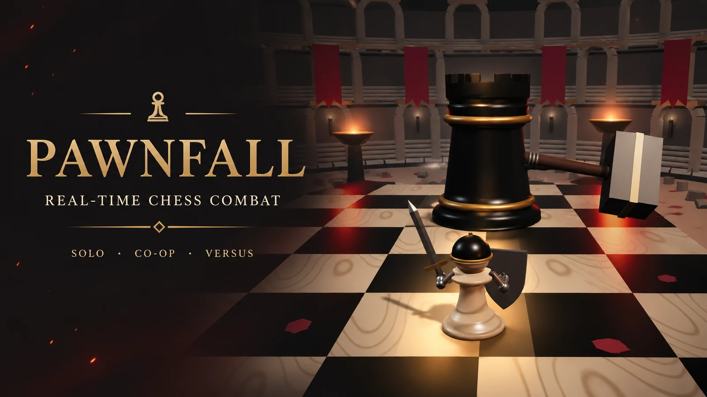
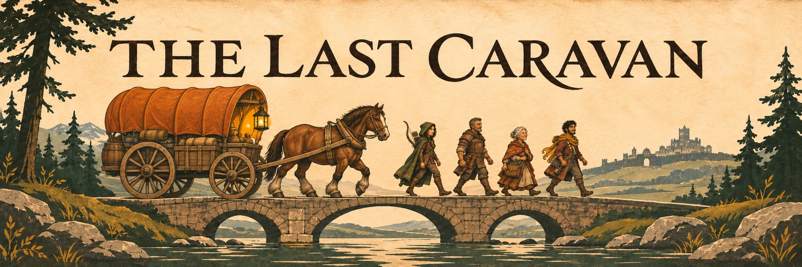

# 🎮 Browser Games

A collection of browser games and web experiments. Each project lives in its own folder, with its own source code, assets, dependencies, and documentation.

## 🕹️ Games

### Pawnfall



A real-time 3D chess souls-like combat game with solo campaigns, endless encounters, co-op adventures, and duels.

[Explore Pawnfall](PawnFall/) · [Read the instructions](PawnFall/README.md)

### The Last Caravan



A single-player survival strategy game. Guide four travelers to the Last City, manage supplies and injuries, and make decisions that can change the road ahead.

[Explore The Last Caravan](TheLastCaravan/) · [Read the instructions](TheLastCaravan/README.md)

## 📁 Repository Structure

```text
Games/
│
├── README.md
│
├── PawnFall/
│   ├── README.md
│   └── ...
│
└── TheLastCaravan/
    ├── README.md
    └── ...
```

## About this repository

Games are maintained independently and may use different technologies or require different setup steps. Open a game's folder and follow its README for installation, controls, and other details.

New games will be added alongside the existing projects, each with its own folder and documentation.
