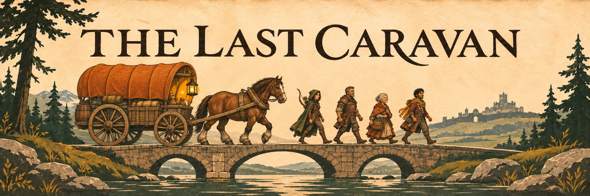
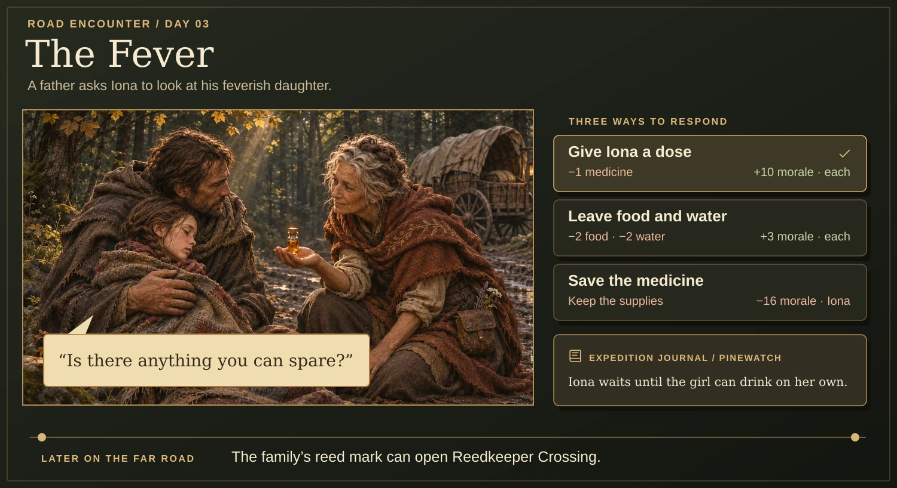
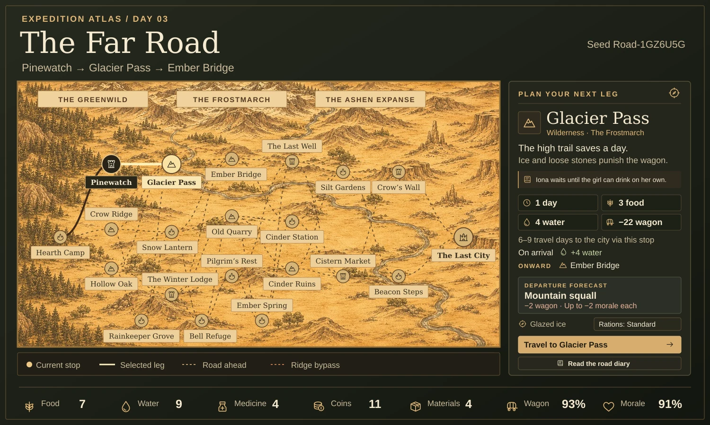
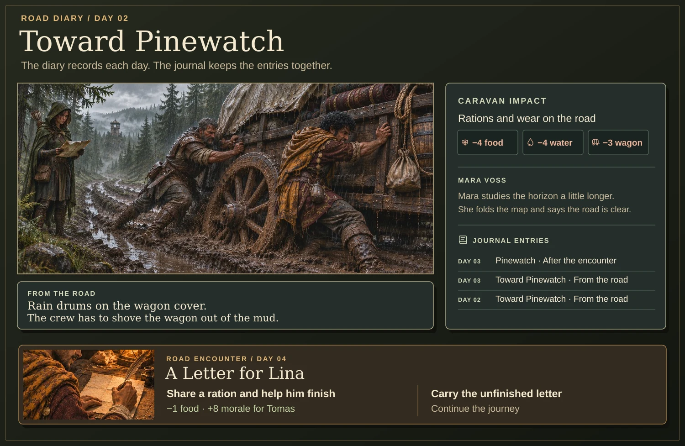
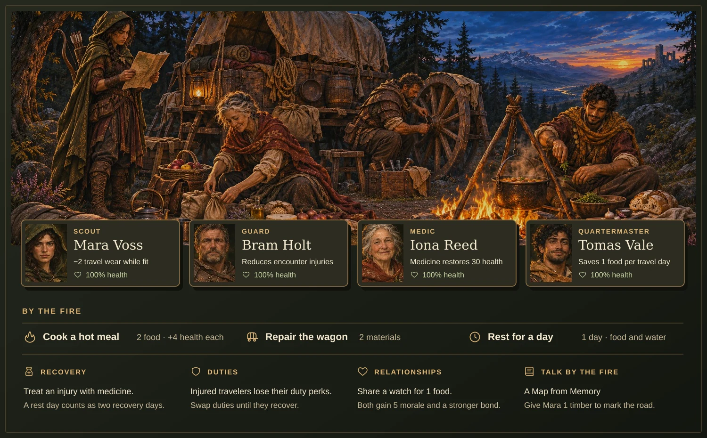
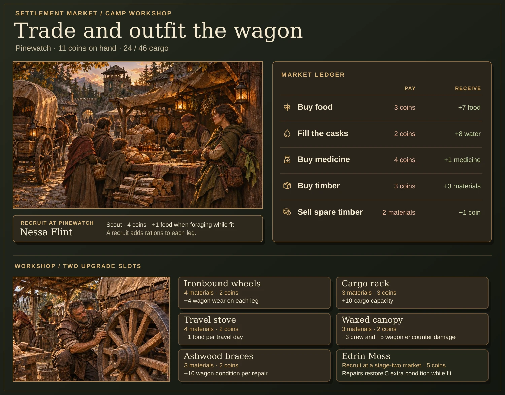
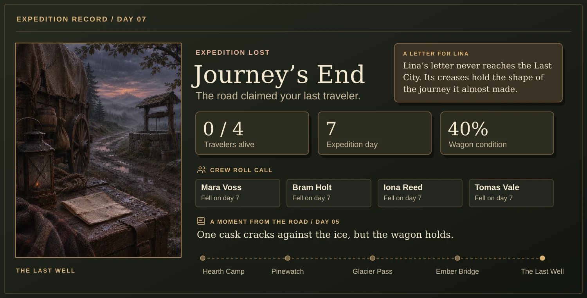

# The Last Caravan



**One wagon. A dying kingdom. Get your people home.**

The Last Caravan is a single-player survival strategy game for the browser. Guide four travelers from Hearth Camp to the Last City. Choose which roads to risk, keep the wagon moving, and decide what you can spare when someone asks for help.

[Run locally](#run-locally) · [Gameplay](#gameplay) · [Expedition routes](#expedition-routes) · [Development](#development)

## Gameplay

Follow one expedition from a choice at Pinewatch to a crossing in the Frostmarch. The previews are illustrated with route names, costs, and outcomes from the game.

### A choice at Pinewatch

Illustrated encounters show what each choice costs. Spend medicine on a stranger, share a ration to help Tomas finish his letter, or save those supplies for the next leg. Some decisions open routes later in the journey. The **Journal** records the story alongside the impact on supplies and travelers.



### Over Glacier Pass

Use the **World Map** to compare travel time, food and water costs, wagon wear, and departure weather. A shorter pass can save a day and still leave you worse off if it damages the wagon. Settlements offer a chance to trade before the next stretch.



### From the road diary

The diary breaks each leg into days and records the actual effects of travel. Open the **Journal** to revisit those entries and the choices you made, including what happened to Tomas’s letter.



### By the fire

At **Camp**, cook, forage, treat injuries, repair the wagon, and reassign duties when someone needs time to recover. Share a watch to build bonds, or talk by the fire to hear a traveler’s story. Injuries can disable a role’s benefits and change the cost of travel. The final roll call records who made it, who fell, and what became of Tomas’s letter to Lina.



### In town and at the workshop

At a settlement, spend coins on food, water, medicine, and timber, or sell spare timber. Some settlements offer recruits. At camp, choose two wagon upgrades and weigh their benefits against the supplies you have left.



<details>
<summary>See how this expedition ends</summary>



</details>

## Expedition routes

| Route             | What to expect                                                                                                                             |
| ----------------- | ------------------------------------------------------------------------------------------------------------------------------------------ |
| **The Far Road**  | The longest journey, with three possible opening encounters, late markets and supply caches, and a crossing unlocked by an early decision. |
| **The Long Road** | Supply detours, a ridge bypass, and weather that changes as time passes.                                                                   |
| **The Road East** | A shorter expedition with fixed road conditions.                                                                                           |

Choose a route, starting caravan, and optional seed under **New expedition**. **Records** tracks completed runs and achievements. Replay a recent run’s seed from its record, or choose one of the starting caravans you’ve unlocked.

## Run locally

Use **Node.js 22.18 or later** and a modern browser. From the project directory, run:

```sh
npm ci
npm run dev
```

Open the URL printed by Vite. **How to play** opens the in-game guide. The game runs entirely in the browser.

- **Saves.** Your expedition, records, and settings are stored in the browser for that site. Use **Settings → Portable saves** to export or import a JSON backup.
- **Language.** Switch between English and فارسی in the header or settings. Persian uses a right-to-left layout, Persian numerals, and translated dialogue. Noto Sans Arabic is bundled. If you have a licensed copy of the Peyda variable webfont, place it at `src/fonts/Peyda.woff2` before starting or building.
- **Graphics and sound.** The campsite uses Babylon.js and WebGL, with an illustrated fallback. Settings include sound, volume, and campsite animation.

## Development

```sh
npm run format:check
npm test
npm run build
npm run preview
```

Use `npm run format` to apply Prettier formatting. The build type-checks TypeScript and writes the static game to `dist/`. Serve the contents of `dist/` over HTTP. Asset paths support deployment at a site root or a repository subpath, including GitHub Pages.

| Path                                             | Responsibility                                                           |
| ------------------------------------------------ | ------------------------------------------------------------------------ |
| `src/game.ts`, `src/content.ts`                  | Expedition state, travel, camp, trading, encounters, and save migration. |
| `src/frontier.ts`, `src/far-road.ts`             | Route variants, weather, detours, and story-dependent crossings.         |
| `src/main.ts`, `src/views.ts`, `src/style.css`   | Browser interface and player actions.                                    |
| `src/chronicle*.ts`, `src/letter.ts`             | The illustrated diary and Tomas’s letter.                                |
| `src/camp-scene.ts`, `src/audio.ts`              | 3D camp rendering and game audio.                                        |
| `src/profile.ts`, `src/backup.ts`, `src/fa-*.ts` | Run records, portable saves, and Persian translations.                   |
| `public/`, `docs/images/`                        | Runtime artwork and fonts, and README previews.                          |
| `tests/`                                         | Regression tests.                                                        |

The bundled Noto Sans Arabic font license is included in [public/fonts](public/fonts/NotoSansArabic-LICENSE.txt).
